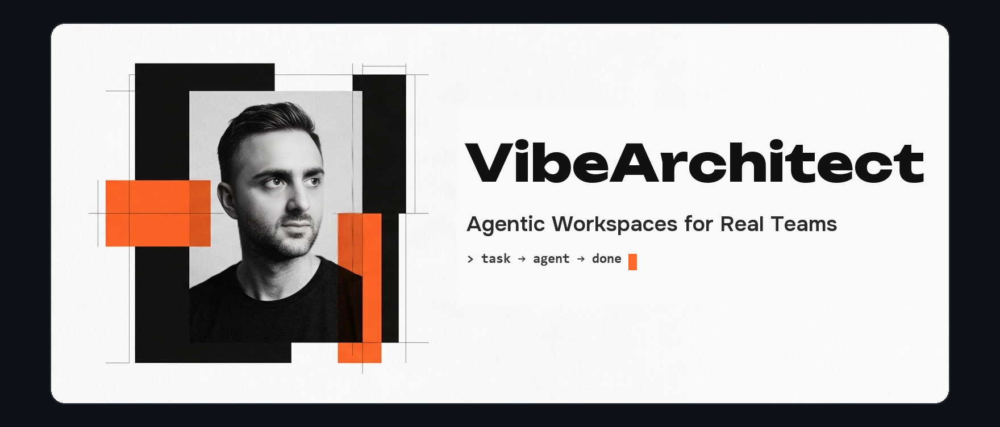

## Hi, I'm Sergey 👋

Program & business architect with 15 years in transformation and IT programs (shared services, gas-supply logistics, PMO). I build agentic workplaces and help teams delegate whole tasks to AI agents.

### What I do

- **[Forja](https://github.com/khsergey-afk/forja-concept)** — corporate agentic workspace: teams hand over whole tasks, an AI agent plans the steps, pulls data from corporate systems (1C, CRM, databases) and returns a ready file — report, contract, presentation.
- **PM & methodology** — end-to-end service models for shared services (catalog of services, SLA/OLA, process-role models, KPI-SLA measurement systems), program governance, change management in four phases; PMBoK/Agile, BPMN, ITIL 4-aligned design; deep expertise in gas-industry methodology and practice.
- **Prompt engineering & agent environments** — structured agent environments built on Claude Code: role libraries, skill systems, subagents, data boundaries. Certified: «Vibe-Coding with Claude Code» (Zerocoder University, 30 academic hours, 2026).

### Portfolio

| Repository | What it shows |
|---|---|
| [forja-concept](https://github.com/khsergey-afk/forja-concept) | product concept of Forja: the last mile of agentic work — task in, accepted document out |
| [omniscope-concept](https://github.com/khsergey-afk/omniscope-concept) | multi-discipline analysis orchestrator: 6 specialist agents, verified Excel / Word / PPTX / Visio / MS Project output |
| [pm-portfolio](https://github.com/khsergey-afk/pm-portfolio) | methodology case portfolio: shared services center end-to-end, business architecture, requirements engineering — with author's methods and checklists |
| [pmptrainer-concept](https://github.com/khsergey-afk/pmptrainer-concept) | PMP exam practice bot for Telegram: 172-question bank, Leitner-box spaced repetition, mistake queue |

### Contacts

- ✉️ kh.sergey@googlemail.com
- 💬 Telegram channel: [@SuperAI_Consultant](https://t.me/SuperAI_Consultant) · personal: [@KhSergey](https://t.me/KhSergey)
- 🌐 [ai-po-delu.ru](https://ai-po-delu.ru)

---

## По-русски

Руководитель проектов и бизнес-архитектор, 15 лет в трансформационных и ИТ-программах (общие центры обслуживания, логистика поставок газа, проектный офис). Проектирую сквозные сервисные модели ОЦО — каталог услуг, SLA/OLA, процессно-ролевые модели, управление изменениями в четырёх фазах; собираю агентные рабочие места и учу команды передавать задачи целиком ИИ-агенту. Сертификат «Vibe-Coding with Claude Code» (Zerocoder, 2026). Подробнее — в англоязычной части и в репозиториях портфолио.
